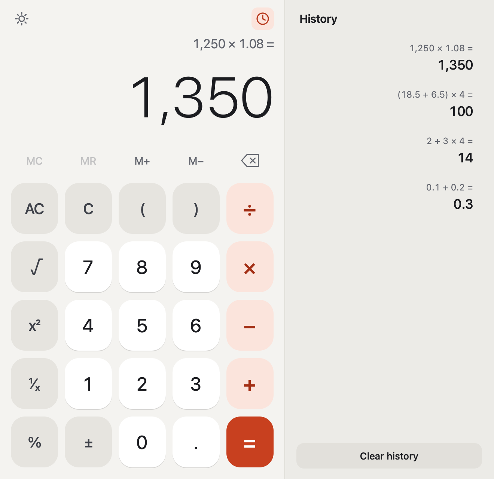
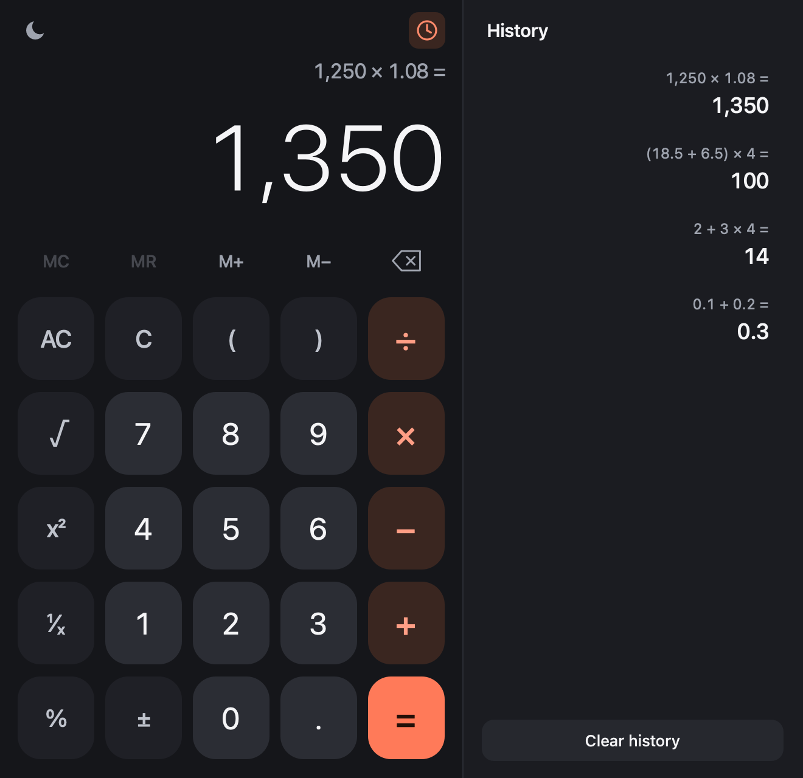

# Calculator

A polished desktop calculator for macOS, built with Python and PySide6 (Qt).

<p>
  
  
</p>

It does everything a good standard calculator should: correct operator
precedence, parentheses, percent, square root, square, reciprocal, memory and
repeat-equals. Arithmetic uses exact decimals, so `0.1 + 0.2` is `0.3`. Input is
handled by a purpose-built parser and never passed to `eval` or `exec`.

- **Two-line display:** the full expression above a large value, with thousands
  separators. Long numbers shrink to fit, and only very large or very small ones
  switch to scientific notation.
- **History:** a toggleable side panel that persists between launches. Click an
  entry to reuse its result.
- **Themes:** light and dark, following the macOS setting or chosen manually.
- **Keyboard first:** every button has a key, and the matching on-screen button
  lights up when you press it.
- **Friendly errors:** messages like "Can't divide by zero" clear on the next
  keypress.

## Download

**[Download Calculator for Mac](https://github.com/yashwanted/Calculator-App/releases/latest/download/Calculator.dmg)**
(about 17 MB)

Requires a Mac with Apple Silicon (M1 or later) and macOS 26 or newer. It won't
run on Intel Macs.

1. Open `Calculator.dmg` and drag **Calculator** onto **Applications**.
2. Double-click Calculator in Applications. macOS will show a security warning
   the first time, because this free app isn't signed with a paid Apple Developer
   account. Follow the steps below to open it.
3. Click **Done** in the warning.
4. Open **System Settings > Privacy & Security** and scroll down to **Security**.
5. Click **Open Anyway** beside the Calculator message, then confirm with your
   password or Touch ID.

You only need to do this once. macOS has its own Calculator, so if Finder won't
let you drag this one into Applications, keep the disk image open and run this in
Terminal instead:

```bash
ditto /Volumes/Calculator/Calculator.app /Applications/Calculator.app
```

Spotlight will then list two apps called Calculator; this one has the coral icon.

## Set up and run

To run from source, you need macOS and Python 3.10 or newer.

```bash
python3 -m venv .venv
```

```bash
source .venv/bin/activate
```

```bash
pip install -r requirements.txt
```

```bash
python3 main.py
```

## Build the app

To build a double-clickable `Calculator.app` and a `Calculator.dmg` to share:

```bash
./build_app.sh
```

This sets up what it needs, draws the icon, builds with PyInstaller, signs the
app ad-hoc, runs a self-test inside the finished app, and creates the disk image.
The results are `dist/Calculator.app`, about 62 MB, and `dist/Calculator.dmg`,
about 17 MB. The app only runs on Macs with the same processor type as the one
that built it, and the macOS version it needs depends on the Python used to build
it. With Homebrew's Python that's macOS 26, set by `LSMinimumSystemVersion` in
`Calculator.spec`.

### Publish a download

The disk image goes on a GitHub Release rather than in the repository. Create a
release named after the version, such as `v1.0.1`, paste
`packaging/release_notes.md` as its description, and attach `dist/Calculator.dmg`.
Keep that file name, because the download link above always fetches
`Calculator.dmg` from the latest release.

### Install it in Applications

macOS has its own Calculator in `/System/Applications`, and Finder shows that one
in the Applications folder too. Your copy can sit beside it, but use Terminal to
install it, because Finder may object to the matching name:

```bash
ditto dist/Calculator.app /Applications/Calculator.app
```

Spotlight will then list two apps called Calculator; yours has the coral icon.

To install a newer build, remove the old copy first:

```bash
rm -rf /Applications/Calculator.app && ditto dist/Calculator.app /Applications/Calculator.app
```

### If macOS says it can't be opened

An app you built on this Mac normally opens straight away. Copying it from
another Mac or downloading it can trigger a warning, because it's signed ad-hoc
rather than with an Apple Developer ID.

**"Apple could not verify…" or "unidentified developer":**

1. Click **Done** in the warning.
2. Open **System Settings > Privacy & Security** and scroll down to **Security**.
3. Click **Open Anyway** beside the Calculator message, then confirm with your
   password or Touch ID.

**"Calculator is damaged and can't be opened":** remove the download marker, then
open the app again:

```bash
xattr -dr com.apple.quarantine /Applications/Calculator.app
```

**Neither of those helped:** sign the installed copy again:

```bash
codesign --force --deep --sign - /Applications/Calculator.app
```

## Keyboard shortcuts

| Action                     | Key             |
| -------------------------- | --------------- |
| Digits, decimal point      | `0`–`9`, `.`    |
| Add, subtract              | `+`, `-`        |
| Multiply, divide           | `*` or `X`, `/` |
| Equals                     | `Enter` or `=`  |
| Parentheses                | `(`, `)`        |
| Percent                    | `%`             |
| Delete last character      | `Backspace`     |
| Clear entry                | `Esc` or `C`    |
| All clear                  | `A`             |
| Change sign                | `N`             |
| Square root                | `R`             |
| Square                     | `Q`             |
| Reciprocal (1/x)           | `I`             |
| Memory add, subtract       | `M`, `Shift+M`  |
| Memory recall, clear       | `K`, `L`        |
| Copy result                | `Cmd+C`         |
| Paste number or expression | `Cmd+V`         |
| Show or hide history       | `H` or `Cmd+Y`  |
| Change appearance          | `T`             |
| Minimize window            | `Cmd+M`         |
| Close window               | `Cmd+W`         |

The same list is in the app under **Help > Keyboard Shortcuts**. The Help menu
also links to this page and to the latest release, and **Calculator > About
Calculator** shows which version you have.

## How it behaves

- **Percent** depends on context: `50 %` is `0.5`, `200 + 10 %` is `220`, and
  `200 × 10 %` is `20`.
- **Repeat equals** repeats the last operation: `2 + 3 = =` gives `8`. In
  `2 + 3 × 4 = =`, the repeated operation is `× 4`, which gives `56`.
- **After a result**, an operator continues from it and a digit starts fresh.
- **C** clears the current number. Pressed again, or with nothing to clear, it
  clears everything. **AC** always clears everything. Neither touches memory or
  history.
- **Missing closing parentheses** are added for you when you press equals.
- **Copy** gives a plain number with no separators, ready to paste elsewhere.
- **Paste** accepts numbers and expressions such as `1,200 × (2 + 3)`. Invalid
  text shows "Invalid input" briefly and leaves your calculation untouched.

## Run the tests

```bash
python3 -m pytest
```

## Where data is stored

The built app and `python3 main.py` share the same files, and nothing is ever
stored inside the app bundle.

- **History:** `~/Library/Application Support/Calculator/history.json`, limited
  to the latest 500 calculations.
- **Window size, theme, history panel state:**
  `~/Library/Preferences/com.calculator-local.Calculator.plist`.

## License

Released under the [MIT License](LICENSE).

## Project structure

```
main.py                 Entry point
calculator/engine.py    Parsing, evaluation, memory and key logic (no UI code)
calculator/ui.py        PySide6 window, custom widgets, themes and app icon
calculator/history.py   History storage
calculator/selftest.py  Checks run inside the built app by build_app.sh
tests/test_engine.py    Tests for the engine and history storage
tests/test_ui.py        Tests for the menus and Help windows
build_app.sh            Builds, signs and tests the app, then creates the disk image
packaging/release_notes.md  Description for the GitHub Release page
Calculator.spec         PyInstaller recipe: bundle details and what to exclude
packaging/make_icns.py  Creates packaging/Calculator.icns from the app's icon
packaging/make_dmg_background.py  Draws the disk image window's background
packaging/dmg_settings.py  Disk image window layout, used by dmgbuild
docs/                   Screenshots for this README
requirements.txt        Everything needed to run, test and build the app
```

When run with `python3 main.py` rather than as the built app, the Dock may label
it "Python" even though the window and menu bar say "Calculator".
Good Luck
